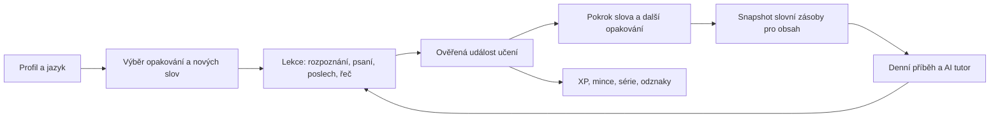

# LinguaCore / PolyFlow — plán implementace

Datum: 3. října 2026. Výchozí stav: `main`, commit `f4f093d`.

Plán převádí dodanou specifikaci LinguaCore na implementační kroky v repozitáři PolyFlow. Popisuje budoucí práci; položky nejsou prohlášením, že už fungují. Jméno produktu lze později změnit v českých UI textech; přejmenování repozitáře, služeb a databáze není podmínkou vývoje.

## 1. Výsledek a rozsah

Rodina si nasadí aplikaci přes Docker Compose, vytvoří dospělé a dětské profily a učí se němčinu, francouzštinu, italštinu a angličtinu z češtiny (angličtina doplněna 4. 10. 2026; britský pravopis a hlas). Každý profil má samostatný pokrok v každém jazyce. Denní rutina propojí opakování, nová slova, přizpůsobený text s audiem, otázky k porozumění a volitelný rozhovor. Gramatické minilekce se odemknou po zvládnutí prvních 1000 slov.

Frekvenční milníky jsou **100 → 500 (A1) → 1000 (A2) → 2500 (B1) → 4000 (práh B2) → 5000 (plné B2)** lemmat na jazyk; 5000 je konec povinné části. Nad 5000 následuje **dobrovolné rozšíření 6000+** zaměřené na pasivní slovní zásobu, bez tvrzení o úrovni CEFR: kdo chce, může se dál učit a trénovat, ale aplikace jasně říká, že postup k C1 přichází z reálného používání jazyka (lidé, kultura, média), nikoli z aplikace. Cílem vzdělávacího obsahu je podpora dovedností do B2. Štítky A1/A2/B1/B2 u milníků jsou orientační; dosažení 5000 slov se nebude vydávat za dosažení B2. Čtení, poslech, psaní a komunikace dostanou vlastní úlohy a přehled dovedností. CEFR používá deskriptory jednotlivých kompetencí, z čehož plyne toto oddělení slovní zásoby a úrovně. [Rada Evropy: popis úrovní CEFR](https://www.coe.int/en/web/common-european-framework-reference-languages/level-descriptions).

Provozní cíl: verzované závislosti a modely, opakovatelné nasazení z čistého stroje, JSON logy a přehled zdraví systému bez ruční konfigurace každé služby. Reprodukovatelnost nasazení nezaručuje identické odpovědi LLM; skutečně použitý výstup a jeho původ se uloží.

## 2. Co už existuje

Stav vychází z kontroly zdrojových souborů, nikoli z ověřeného běhu celé aplikace.

| Oblast | Současný stav | Navazující práce |
|---|---|---|
| Backend | FastAPI, konfigurace, JSON logy, request ID, health/readiness API | Autentizace, doménové služby a výuková API |
| Data | PostgreSQL modely profilů, lexikonu, pokroku, blacklistu a denních příběhů; dvě migrace | Události učení, plán opakování, obsahové úlohy, audio a odměnová historie |
| Slovník | Idempotentní CSV import, validace; 20 ukázkových lemmat pro každý jazyk | Úplné ověřené seznamy a dohledatelný původ dat |
| Milníky | Doména, API, UI a testy používají 100/500/1000/2500/4000/5000 a dobrovolné 6000+; migrace `0002` zrušila strop 2500 | Zachovat kontrakt; navázat na něj výběr lekcí a pasivní zaměření rozšíření |
| Worker | ARQ + Redis, pouze úloha `ping` | Plánování, ingest, transformace, validace, TTS, decay a retry |
| Audio | Docker služby Piper a faster-whisper; endpoint přepisu s pravděpodobnostmi slov | Integrace do lekcí, cache, řízení souběhu a validované hodnocení |
| Frontend | Next.js, české texty, dashboard shell, health a seznam milníků | Profily, lekce, příběhy, dialog, odměny a rodičovská správa |
| Nasazení | Vývojový Compose, produkční frontend image, lockfiles, definované CI kontroly | Produkční Compose, zamčené modely/obrazy, smoke test, zálohy a obnova |

Hlavní místa změn: `backend/app/domain/`, `backend/app/services/`, `backend/app/api/`, `backend/app/workers/`, `backend/app/models/`, `backend/alembic/`, `backend/tests/`, `frontend/app/`, `frontend/components/`, `frontend/lib/i18n/cs.ts`, `docker/` a `.github/workflows/ci.yml`.

## 3. Rozhodnutí pro implementaci

1. **Zachovat modulární monolit:** FastAPI + SQLAlchemy/Alembic + PostgreSQL, Next.js a ARQ/Redis. Specifikace uvádí více možností scheduleru; stávající ARQ bude obsluhovat noční úlohy i retry. Další scheduler ani migrace na Celery nejsou potřeba.
2. **Zachovat platné milníky:** kontrakt `app/domain/progression.py` (100/500/1000 A2/2500 B1/4000 práh B2/5000 plné B2, nad 5000 dobrovolné 6000+) je v souladu se zadáním a zůstává zdrojem pravdy pro API, české texty, dokumentaci a testy. Rank lexikonu nemá horní strop (migrace `0002`); `frequency_band` počítá importér. Slova nad 5000 jsou dobrovolná, výběr lekcí u nich upřednostní rozpoznání před produkcí a nikdy je nevyžaduje ani nepřipomíná. Historické migrace nepřepisovat.
3. **Oddělit měření a prezentaci skóre:** databáze už používá rozsah 0–1, UI zobrazí 0–100. `NULL` znamená „dosud nezměřeno“. Přidat `last_seen_at`, `next_review_at` a údaje pro retenční model; stávající `last_reviewed_at` a `last_error_free_at` mají jiný význam.
4. **Zachovat otevřený přístup k procvičování:** milníky řídí doporučené pořadí, nikoli počet povolených chyb. Jediným zadaným pedagogickým odemčením je gramatický modul po 1000 slovech; při decay se už získaný přístup znovu nezamkne.
5. **LLM přes společné rozhraní:** lokální endpoint jako výchozí možnost, cloud jako volitelná explicitní konfigurace. Adaptéry pro generování, dialog a závěrečnou zpětnou vazbu sdílejí validaci, timeouty a evidenci modelu. Automatický přechod z lokálního provozu do cloudu nebude výchozí chování.
6. **Výslovnost vyžaduje vlastní ověření:** Whisper poskytne přepis, časování a jistotu rozpoznání. Současný wrapper sám upozorňuje, že tato jistota není kalibrované hodnocení výslovnosti. Průměr jeho pravděpodobností se proto neuloží jako `phonetic_score`. Pro tento plán je potřebný samostatný experiment s fonetickým zarovnáním a akustickým hodnoticím modelem. [Implementace faster-whisper](https://github.com/SYSTRAN/faster-whisper/blob/master/faster_whisper/transcribe.py).

## 4. Toky a datové kontrakty

### Výukový tok

### Změny datového modelu

| Model / záznam | Účel a zásadní pravidla |
|---|---|
| Profily a přístup | Přihlašovací session, správce (přístup a obsah), dětský filtr obsahu, nastavení profilu a časové pásmo; oprávnění kontroluje backend |
| Pokrok uživatel–slovo | Zachovat existující unikátní dvojici; doplnit expozici, plán opakování a verzi retenční politiky |
| Událost učení | Profil, jazyk, slovo, typ úlohy, odpověď/výsledek, čas, session, verze hodnoticí politiky a idempotency key |
| Výuková session | Serverem vydané úlohy, cílová slova, skutečné pokusy a dokončení; klient nemůže sám přidělit zvládnutí ani XP |
| Obsahový zdroj a položka | Jazyk, kategorie, věková vhodnost, URL, původ, datum, obsahový hash a podmínky použití |
| Generační běh | Profil, jazyk, lokální datum, snapshot znalostí, cílová slova, fáze, retry a diagnostika |
| Denní příběh | Rozšířit existující model o validační zprávu, schválení, verze promptu/politik a vazbu na audio |
| Audio asset | Hash textu, jazyk, hlas/model a jeho revize, parametry, délka, cesta, stav a checksum |
| Konverzační session | Kontext a tahy dialogu, cílová slova, závěrečné opravy; soukromý přístup a nastavitelná retence |
| Gramatický pokrok | Odemčení per profil/jazyk, lekce, ověřené výsledky a procvičované vzorce |
| Odměnový ledger | Jedinečná odměna za konkrétní událost; saldo a výdaje v transakci; historie odznaků a odemčených miniher |

Přesné názvy nových tabulek a OpenAPI schémata se dopracují v příslušné fázi. Každá fáze přidá vlastní migraci a kontrolu souladu modelů s databází.

### Pravidla slovní zásoby a opakování

- `NEW → LEARNING` po prvním vyhodnoceném pokusu; samotné zobrazení nastaví `last_seen_at`, nikoli znalost.
- `passive_known` se získává rozpoznáním významu nebo porozuměním bez nápovědy; `active_known` samostatnou produkcí. Výsledek nahrávky s nejistým přepisem není automaticky chybou ani důkazem znalosti.
- Výchozí, verzovaná pilotní politika: pasivní znalost po třech správných rozpoznáních na alespoň dvou různých dnech; aktivní po třech správných produkcích na alespoň dvou dnech. Nápovědou odhalená odpověď se nezapočítá. Prahy se upraví podle pilotních výsledků.
- `MASTERED` vyžaduje obě znalosti a úspěšné odložené ověření alespoň po sedmi dnech. Mikrofon nebude povinný: správná písemná produkce může doložit aktivní znalost, výslovnost zůstane nezměřená.
- Gramatické minilekce se odemknou, jakmile profil v daném jazyce zvládne první frekvenční blok 1000 lemmat. Jednoduché gramatické vzorce se přirozeně objevují v textech už před odemčením.
- Po více než 30 dnech bez bezchybného ověřeného použití se slovo vrátí do prioritního opakování. `retention_decay` sníží efektivní retenční skóre podle času od posledního úspěchu. Původní naměřenou pravopisnou/fonetickou přesnost uchovat; efektivní skóre počítat ze stejného základu, aby opakovaný běh neprováděl další násobné snížení.
- Výběr lekce preferuje splatná opakování, chybovaná slova a potom malou dávku nových lemmat. Množství, intervaly i decay parametry patří do verzované politiky, ne do promptu LLM.

### Noční obsahová pipeline

`naplánování → ingest → výběr zdroje → snapshot profilu → LLM přepis → jazyková a bezpečnostní validace → TTS → publikace`

1. Denní plán ve **03:00 Europe/Prague**, konfigurovatelný pro domácnost. Klíč běhu je `(profil, jazyk, lokální datum)`; startup reconciliation doplní zmeškaný běh. Testovat změnu letního času a souběžné workery. ARQ podporuje časové pásmo scheduleru a může úlohy provést opakovaně, proto trvalá idempotence bude v databázi. [Dokumentace ARQ](https://arq-docs.helpmanual.io/).
2. Schválené RSS zdroje pro dospělé a předem kurátorované pohádky pro děti. Scraping jen u zdrojů, kde je použití povolené; ukládat původ a hash, odstranit HTML a deduplikovat. Stažení má timeout, limit velikosti a povolené cíle.
3. Snapshot obsahuje pasivně známá slova pro porozumění, aktivně známá slova, doporučenou gramatiku, zájmy, věkový režim a 3–5 cílených nových lemmat.
4. Strukturovaný výstup: titul, text, cílová slova a kontrolní otázky s odpověďmi a vazbou na konkrétní úsek příběhu. Kontrola otázek i správných odpovědí proběhne stejně jako kontrola textu.
5. Tokenizace a lemmatizace pro DE/FR/IT/EN ověří lexikální pokrytí včetně ohýbání, kontrakcí, složenin a oddělitelných předpon. **2–5 %** je pilotně podíl výskytů dalších neznámých obsahových slov, mimo známou množinu a mimo 3–5 cílených lemmat; interpunkce se nepočítá. Zvlášť ukládat tento poměr i celkový poměr neznámých slov včetně cílových. Náhodná slova vybírat řízeně ze schváleného slovníku, bez duplicit a nevhodných témat.
6. Validovat délku, jazyk, gramatické mantinely, zahrnutí cílových slov, lexikální poměry a oporu odpovědí v textu. Nejvýše dva opravné pokusy po prvním generování. Pro velmi začínající profil může být zadání nesplnitelné; použít schválený jednoduchý fallback a zaznamenat odchylku, nikoli zveřejnit neověřený výstup.
7. Dětský režim používá schválené zdroje, oddělení nedůvěryhodného zdrojového textu od instrukcí, blacklist/regex, kontrolu témat a schválení finálního výstupu. Při neúspěchu nebo nedostupnosti kontroly se obsah nezpřístupní. Prompt a regex samy neposkytují záruku bezpečnosti; ověřování zahrne parafráze, vícejazyčné obcházení a prompt injection.
8. Audio vzniká až ze schváleného textu, s hlasem odpovídajícím jazyku. API vydá pouze publikovaný obsah a schválené audio. Výpadek TTS dovolí schválené čtení s viditelným stavem „audio se připravuje“; nový generovaný text bez validace tuto výjimku nemá.
9. Fáze mají uložené checkpointy, omezené retry s backoff, timeout a trvalý stav selhání. Restart nesmí vytvořit druhý příběh ani znovu účtovat dokončenou fázi. Změna blacklistu/veřejnosti profilu vyvolá revalidaci před dalším vydáním obsahu.

## 5. Fáze a kritéria dokončení

Každá fáze je samostatně přezkoumatelná změna s migracemi, API/UI tam, kde jsou potřeba, a kontrolami uvedenými níže. Časové odhady se stanoví po ověření cílového hardware a zvolených modelů.

| Fáze | Dodávka | Závislost | Kritérium dokončení |
|---|---|---|---|
| P0 | Ověřený základ | — | Milníky do 5000 + dobrovolné 6000+ ověřené v API/UI; zachovaný pokrok; čisté CI a spuštěný Compose smoke test |
| P1 | Rodinné profily a přístup | P0 | Oddělený pokrok profilů/jazyků; dítě nemůže změnit bezpečnostní režim ani číst cizí data |
| P2 | Lexikální motor a první funkční lekce | P1 | Rozpoznání, psaní, stav znalosti, plán opakování a decay fungují od UI po DB |
| P3 | Poslech, řeč a ověření fonetického hodnocení | P2 | Piper a přepis fungují pro DE/FR/IT/EN; jistota přepisu a výslovnost mají odlišné kontrakty |
| P4 | Denní personalizovaný obsah | P2, TTS z P3 | Noční běh i manuální spuštění vytvoří bezpečný text, otázky a audio bez duplicity |
| P5 | Gramatika a AI tutor | P2–P4 | Odemčení minilekcí; psaný a mluvený dialog; opravy až v rekapitulaci |
| P6 | Gamifikace a tematické minihry | P2; AI hry po P5 | Idempotentní XP/mince, série a odznaky; odemčené hry bez blokování výuky |
| P7 | Produkční provoz a rodinný pilot | P0–P6 | Nasazení/obnova z čistého stroje, observability, přístup z mobilu a přijatelná kvalita všech jazyků |

### P0 — sjednotit základ a ověřit nasazení

- Ověřit kontrakt milníků (do 5000, dobrovolné 6000+) v API, UI a testech a upgrade `0001 → 0002` na databázi s existujícím pokrokem bez ztráty dat.
- Ověřit existující `backend/uv.lock` a `frontend/package-lock.json` pomocí frozen instalací, současné backend testy/lint, frontend typecheck/build a migrations round-trip. Ověřit i databázi s již existujícím pokrokem.
- Spustit čistý Compose a profil audio; ověřit hlasy, přepis i jejich health endpointy. Produkční parametrizaci nezaměňovat s dnešním vývojovým Compose.
- Zdokumentovat cílový počet profilů, CPU/RAM, případnou GPU, prostor pro audio a dostupné lokální LLM. Změřit start modelů, latenci TTS/STT/LLM a souběh; teprve poté stanovit provozní limity.
- Výstup: potvrzený základ, zaznamenané závady a měření; ne pouze úspěšné sestavení image.

### P1 — rodinné profily a oprávnění

- První spuštění vytvoří účet správce (admin) bez otevřené registrace. Přihlášení pomocí serverové session, bezpečné cookies, ochrana zápisů proti CSRF a omezení pokusů o heslo/PIN.
- Správce uděluje přístup (zakládá profily, obnovuje heslo/PIN, deaktivuje) a spravuje společný obsah. Neomezuje, co uživatelé dělají: jazyk, denní cíl a audio si volí každý sám. Každý profil se přihlašuje sám heslem nebo PINem.
- Dětský profil je filtr obsahu podle věku, ne rodičovská kontrola: položky slovníku s `content_flags` (`sexual`, `profanity`, `violence`) se dítěti nezobrazí. Filtr zapíná/vypíná správce. Na sdíleném zařízení může správce otevřít dětský profil ze své session; návrat do správy vyžaduje heslo správce.
- API/UI pro profil, výběr jazyka, denní cíl a nastavení audia. Znalost a gramatické odemčení se vedou per jazyk; změna aktivního jazyka nic neresetuje.
- Kontroly: přímé volání cizích ID, změna `is_child`/role, odhlášení, expirace session a přepnutí profilu.

### P2 — lexikon, evidence učení a drill MVP

- Připravit datovou pipeline pro 5000 frekvenčních lemmat v každém jazyce (plus volitelné rozšíření 6000+ pro pasivní procvičování): slovní druh, český význam, příklady, rod a IPA tam, kde jsou ověřené; evidovat zdroj, licenci a revizi. Začít kurátorovanými prvními 100 slovy všech tří jazyků, další bloky publikovat postupně po kontrole kvality.
- Implementovat události učení, transakční agregaci pokroku a verzovaná pravidla z části 4. Pravopis hodnotit jazykově specificky: Unicode normalizace, diakritika, velikost písmen a povolené varianty; nepoužívat jeden plošný fuzzy práh.
- API pro začátek session, další úlohu, odevzdání odpovědi, dokončení a přehled pokroku. Nápověda a opakovaný pokus jsou dostupné bez limitu; duplicitní odevzdání nemění výsledky podruhé.
- Mobilní UI: zadání, odpověď, vysvětlení v češtině, další pokus, souhrn a návrat na dashboard. Rozlišit načítání, prázdný plán, chybu a dokončenou lekci; po obnově stránky lze pokračovat.
- Kontroly: 30denní hranice decay s řízeným časem, nezměřená skóre, pasivní versus aktivní znalost, idempotence, souběžné pokusy a stabilní import bez resetování pokroku.
- **Rozřazovací test** (doplněno 4. 10. 2026, `app/domain/placement.py`, `app/services/placement.py`): per jazyk, nabídnutý před první lekcí, vždy přeskočitelný a dostupný kdykoli (odkaz v hlavičce, volba jazyka v testu); ptá se i na už naučená slova a chybu u nich počítá jako chybu v Ověření. Adaptivní nad frekvenčním pořadím (posteriorní odhad úrovně na logaritmické ose, otázka u mediánu, konec při dostatečné jistotě, nejvýš 25 otázek), rozpoznání s tlačítkem „Nevím“, bez časového limitu a nápovědy. Správná odpověď napoprvé je jeden doklad jako v Ověření; nic se nepovažuje za známé předpokladem. Slova do odhadnuté úrovně, na která se test neptal, přeskočí lekce a čekají v Ověření na potvrzení; chyba v Ověření je vrátí do lekcí. Test umí určit úroveň jen v rozsahu naimportovaného lexikonu (nyní prvních 100 slov); parametry modelu odpovědí jsou pilotní a nekalibrované.
- **Zkoušky úrovně slovní zásoby A1/A2/B1/B2** (doplněno 4. 10. 2026, `app/domain/level_exam.py`, `app/services/level_exam.py`): per jazyk, spouští je uživatel, bez časového limitu a nápovědy. Pásma podle štítků milníků: A1 1–500, A2 501–1000, B1 1001–2500, B2 2501–5000; úrovně jdou popořadě. Zkouška se otevře, když lexikon obsahuje aspoň 90 % pásma a uživatel pasivně zná aspoň 80 % jeho slov (nebo ho rozřazovací test umístil nad pásmo). Náhodný výběr 30 slov (nejdřív slova, na která se dřívější pokusy neptaly), rozpoznání s „Nevím“; úspěch = aspoň 26 z 30 napoprvé (kritérium Vocabulary Levels Test). Odpovědi se počítají jako Ověření. Úspěch zapíše odznak `level_badges`, který úpadek neodebírá; neúspěch ukáže slova k procvičení a další pokus je možný od dalšího dne. Jde o ověření slovní zásoby, ne o certifikát CEFR. S jádrem 100 slov nelze zatím otevřít žádnou zkoušku; otevřou se samy po importu pásem.

### P3 — audio a fonetické hodnocení

- Jednotný audio adapter, výběr hlasu podle jazyka, persistentní cache a API pro přehrávání. Cache klíč zahrne text, hlas, model/revizi a parametry, aby se nevracela nesprávná verze.
- UI pro poslech, zopakování, rychlost přehrávání a nahrávání s možností místo toho odpovědět písemně. Mikrofon přes HTTPS; stavy odmítnuté oprávnění, ticho, hlučný vstup, timeout a zrušení.
- Přepis STT hodnotit proti očekávanému textu v drillu; v dialogu nepodsouvat správnou odpověď jako důkaz její výslovnosti. Ukládat odděleně confidence, správnost přepisu a skutečné fonetické měření.
- Experiment pro skutečné `phonetic_score`: fonetický vzor, zarovnání známého textu s nahrávkou a akustický hodnoticí model, který pokrývá DE/FR/IT/EN. Experiment začne angličtinou, pro kterou jsou k dispozici hodnotitelé; DE/FR/IT následují. Porovnat s lidským hodnocením na dětském i dospělém hlasu, různých mikrofonech a chybách jednotlivých hlásek. Samotné zarovnání nestačí.
- Před nasazením skóre určit měřitelná kritéria shody s lidským hodnocením. Pokud experiment neprojde, vydat poslech/přepis, ponechat `phonetic_score = NULL` a fonetické hodnocení evidovat jako nesplněnou položku specifikace.
- Audio nahrávky ve výchozím nastavení zpracovat dočasně; dlouhodobé uchování pro porovnání jen po zapnutí rodičem/uživatelem. Zavést limity velikosti, délky a souběhu, které vyplynou z P0.

### P4 — Batch Engine a čtenář/poslech

- Implementovat kroky pipeline z části 4 v ARQ, trvalé checkpointy v PostgreSQL a persistentní audio volume přístupné workeru i API. Oddělit frontu interaktivního audia od dlouhých nočních úloh.
- Přidat adapter LLM, schémata výstupu, lemmatizační a gramatické validátory, bezpečnostní bránu a registry zdrojů. Zdrojový text nikdy nesmí měnit pravidla generování ani spouštět nástroje.
- UI: denní článek/pohádka, zdroj, označená cílová slova, české vysvětlení po klepnutí, přehrávač a otázky. Odpovědi na otázky vyhodnocuje backend; porozumění celému příběhu samo neprokazuje aktivní znalost každého slova.
- Správa umožní zobrazit stav běhu, důvod odmítnutí a bezpečně zopakovat selhanou fázi. Úplný diagnostický obsah patří pouze do rodičovské správy, nikoli dětského dashboardu.
- Kontroly: nedostupný RSS/LLM/TTS, nesprávné JSON, halucinované odpovědi, příliš mnoho neznámých slov, injection ve zdroji, nevhodný text i otázky, restart během TTS, dva workery a změna bezpečnostní politiky.

### P5 — gramatika a AI tutor

- Kontextové minilekce navázat na známá slova a konkrétní vzorec. Rozhraní jasně ukáže odemčení po 1000 slovech; ověřit oddělení jazyků a trvalost získaného přístupu.
- Nejprve psaný roleplay se streamovanou odpovědí; potom propojit nahrávání/STT, LLM a Piper. Uživatelské tahy nebudou přerušované opravami. Mluvený režim postupně doplní detekci konce tahu a možnost přerušit přehrávání; plynulost ověřit na cílovém hardware, bez předpokladu plného duplexu.
- Tutor využívá známou slovní zásobu, zájmy a omezené množství nových slov. Na konci seance vrátí konkrétní citovanou chybu, správnou variantu, české vysvětlení a navazující procvičování gramatiky, stylu a slovosledu.
- Dětská témata jsou předem schválená; každý výstup pro dítě projde bezpečnostní kontrolou před zobrazením i TTS. U dětského režimu se nepublikuje neověřený tokenový stream. Bezpečnostní zásah platí i během dialogu.
- Pokrok aktualizovat jen z ověřených výukových událostí. Přepis nebo volné tvrzení LLM není samo důkazem, že uživatel zvládl slovo.
- Kontroly: zrušení/reconnect, duplicitní tah, tichá nahrávka, bezpečnostní obcházení, nejistý přepis a zpětná vazba, která si nevymýšlí chyby.

### P6 — motivace a hry

- Serverově vyhodnocované denní cíle, XP, odznaky a série podle časového pásma profilu. Definovat započitatelnou dokončenou lekci a aktivní den; opakovaný request nesmí změnit odměnu.
- Mince pouze za zvládnuté lekce a udržené série. Odměnový ledger má unikátní vazbu na událost; odemčení miniher ověří saldo a provede výdaj atomicky. Opakované nové dokončení stejné lekce může trénovat bez limitu, ale neslouží k neomezenému získávání mincí.
- Nejprve tematický slovní souboj proti AI, potom dobrovolný rodinný souboj: omezené tematické sady, vyrovnání obtížnosti podle profilu, serverové výsledky a ochrana před opakovaným připsáním odměny.
- Série a denní cíle mají podporovat návrat. Výuka pokračuje bez životů, energie, reklam, paywallů, placené obnovy série či povinné soutěže. Ztráta série neodebírá zvládnutý obsah ani již získané mince.
- Kontroly: půlnoc, DST, změna pásma, souběžná dokončení, transakční výdaj a opakované volání odměny.

### P7 — reproducible deployment, observability a pilot

- Produkční Compose použije frontend `runner`, bez vývojových bind mountů; reverse proxy a HTTPS umožní mobilní přístup a mikrofon. Zveřejnit pouze aplikační vstup, ostatní služby ponechat interní.
- Pinovat image digesty, tranzitivní Python/audio závislosti, revize LLM/STT/TTS modelů, hlasy, prompty a seed data v manifestu. Přidat kontrolované stažení s checksumy a prefetch postup pro spuštění s již připravenými modely.
- Profil pro lokální LLM nabídne konkrétní otestovaný runtime dle P0, nebo připojení ke stávajícímu endpointu. Cloudové klíče jsou serverová tajemství; vstupy nikdy neobsahují hesla, identifikátory dětí ani jiné nepotřebné údaje.
- Všechny aplikační služby včetně audio wrapperů mají JSON logy: čas, služba, request/job/session ID, fáze, trvání, stav, provider/model a bezpečný kód chyby. Nelogovat nahrávky, přístupové klíče ani plný osobní obsah; u ARQ vypnout automatické logování citlivých výsledků.
- Výchozí přehled pro správce: API/DB/Redis, heartbeat workeru, délka front, poslední úspěšný batch, počet selhání, disk a dostupnost audio/LLM. Živé upozornění v UI na zmeškaný batch nebo plný disk; export metrik pro volitelný monitoring.
- Zálohovat PostgreSQL, konfiguraci, modelové manifesty a audio metadata/assets. Návod na upgrade, předmigrační zálohu, kontrolované obnovení a přenos na nový stroj; obnova nesmí vymazat pokrok.
- Pilot: dospělý i dětský profil, všechny tři jazyky, mobil i desktop, omezený/odmítnutý mikrofon, několik nočních běhů a výpadek workeru. Ověřit kvalitu českých významů, přirozenost textů, otázky a pedagogické prahy.

## 6. Pořadí dodávek a ověření

**První použitelná verze:** P0 → P1 → P2: profil, prvních 100 ověřených slov v každém jazyce, skutečný drill, trvalý pokrok a opakování.

**Denní obsah:** dokončit TTS část P3 a P4: každé ráno připravený text/pohádka, poslech a otázky. Fonetický experiment může běžet souběžně; jeho neúspěch nesmí blokovat čtení a poslech.

**Kompletní specifikace:** rozšířit ověřený lexikon na 5000 lemmat per jazyk (rozšíření 6000+ je volitelné), dokončit fonetické hodnocení, P5, P6 a produkční P7. Bez validovaného fonetického skóre nebo bez všech požadovaných jazyků není specifikace kompletní.

Minimum před sloučením implementační fáze: relevantní backend testy a lint/format, frontend typecheck/build, integrační testy dotčených DB transakcí a migrací. Výukové toky dostanou E2E test od vytvoření profilu po obnovu pokroku. LLM testy použijí pevné fixture výstupy pro chyby a separátní verzovanou eval sadu pro skutečné modely; náhodně úspěšné generování není jediným CI testem.

Pro plnou dodávku musí projít:

- Nasazení z čistého stroje podle dokumentace, import dat, restart a skutečná obnova ze zálohy.
- Lekce pro každý jazyk mění pouze správný profil a zachová výsledek po obnovení stránky i restartu serveru.
- Více než 30 dní bez úspěchu vrátí slovo do opakování; opakovaný sweep jej nepoškodí dalším umělým snížením.
- Dva workery nebo opakované odevzdání nevytvoří duplicitní příběhy, pokrok či odměny.
- Dětský profil nedostane obsah, otázky, konverzační tah ani audio, které neprošly aktuální bezpečnostní politikou.
- Audio/LLM výpadek má srozumitelný stav a recovery; dostupný textový drill lze dál používat.
- Gramatika se odemkne podle zvládnutí bloku 1000 v daném jazyce; samotné nasbírané XP ji neodemknou.
- UI rozlišuje slovní milníky a komunikační schopnosti; netvrdí dosažení B2 pouze z počtu slov.
- Nad 5000 slov je procvičování dobrovolné, zaměřené na pasivní znalost, bez CEFR štítku a s jasným sdělením, že C1 vyžaduje reálné používání jazyka.

## 7. Otevřené volby pro jednotlivé fáze

Tyto volby neblokují vytvoření plánu ani práci na P0–P2. Musí se uzavřít před implementací závislých funkcí.

| Volba | Výchozí návrh | Kdy rozhodnout |
|---|---|---|
| Název produktu | LinguaCore v produktové dokumentaci; technický checkout zůstává PolyFlow | Před úpravou brandingu |
| Hardware a souběh rodiny | CPU kompatibilní základ, další akcelerace podle měření | P0 |
| Lokální LLM a model | Adapter k lokálnímu endpointu, konkrétní runtime/model po kvalitativním a výkonovém testu | P0/P4 |
| Frekvenční a slovníková data | Kurátorovaných 100 → verzované bloky do 5000, volitelně rozšíření 6000+; ověřené české významy (pokrytí volných zdrojů nad ~5000 slábne) | P2 |
| Prahy znalosti a decay | Pilotní pravidla z části 4; změny verzovat a vyhodnotit na pilotu | P2/pilot |
| RSS a dětská knihovna | Schválený seznam, pro děti kurátorované vhodné pohádky s dohledatelným původem | P4 |
| Hodnocení výslovnosti | Samostatný kalibrační experiment; do úspěchu skóre nezměřeno | P3 |
| Obsah do B2 | Dovednostní úlohy a deskriptory, odborná kontrola gramatické/osobní zpětné vazby | P5/pilot |
| Retence nahrávek a dialogů | Nahrávky dočasně, dialogy s nastavitelnou retencí a možností smazání | P3/P5 |
| Datumy a provozní cíle | Fáze podle závislostí; délku nočního okna a latence určit měřením | Po P0 |
